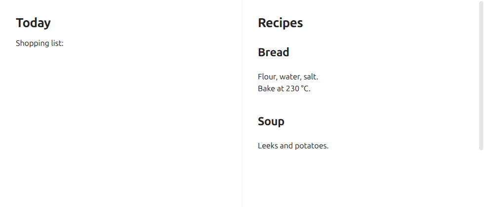
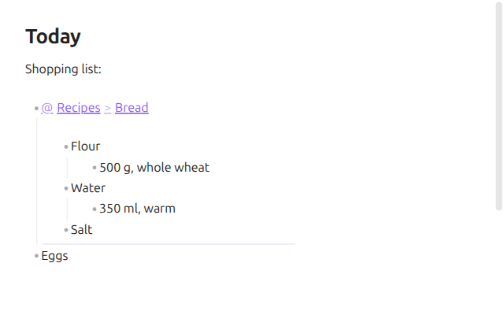

# Live Sections

**Another note's section, editable right where you are.**

Write `@[[Note#Heading]]` on a line. The section opens under it, in Live Preview, and what you type there goes back to the source note.

<picture><source media="(prefers-color-scheme: dark)" srcset="docs/editing-dark.gif"></picture>

Obsidian's own `![[Note#Heading]]` is read only. This one is a real editor.

## Install

Not in the community store: it relies on undocumented Obsidian internals.

Copy `main.js`, `manifest.json` and `styles.css` into `<vault>/.obsidian/plugins/live-sections/`, or add this repo to [BRAT](https://github.com/TfTHacker/obsidian42-brat).

## In practice

**Nested headings**

`@[[Recipes#Bread#Sourdough]]` picks the Sourdough under Bread, not another Sourdough.

**Collapse it**

Folds like a list item, with your own fold shortcut.

<picture><source media="(prefers-color-scheme: dark)" srcset="docs/collapsing-dark.gif"></picture>

**Quiet form**

`!@[[Recipes#Bread]]` keeps the title faint, so the section reads as part of your note.

**Previews and reading view**

They show the section too, read only.

**Keyboard**

Arrow keys step in and out of the section. Escape goes back to the `@` line.

Settings, loops, the full keyboard table and the tests: [docs/usage.md](docs/usage.md).

## Limits

- Long or deeply nested content inside a bullet gets extra space at the start of each line.
